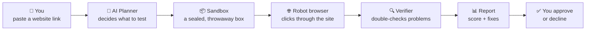
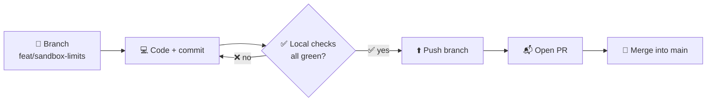
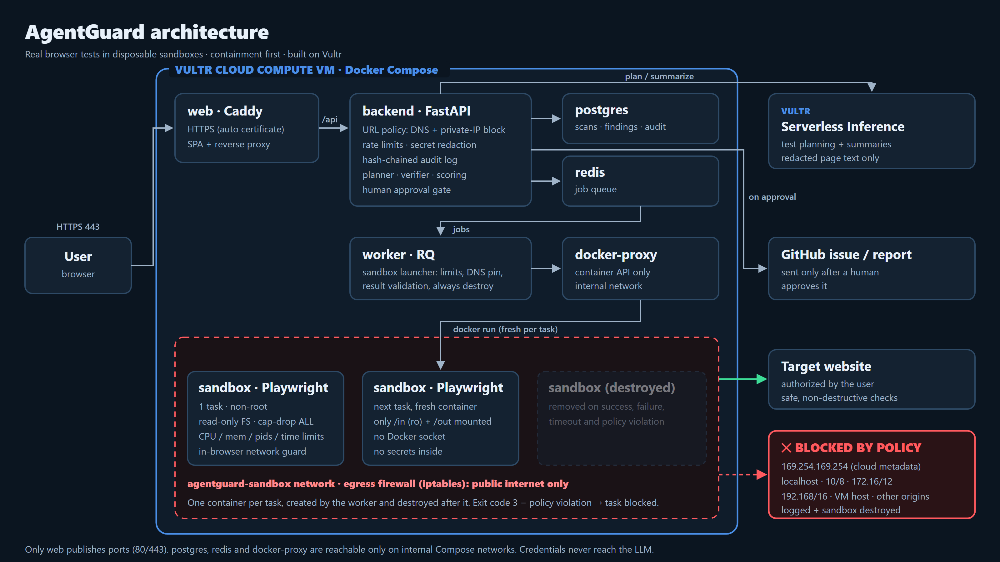

<div align="center">

# 🛡️ AgentGuard

### Your AI QA & security engineer that tests websites *before* real users do

**You give it a website link → it clicks through the site like a real person → it tells you what's broken or unsafe, with proof and how to fix it.**


[🤔 What is it](#-what-is-agentguard) · [⚙️ How it works](#️-how-it-works) · [🚦 Status](#-project-status) · [🚀 Quick start](#-quick-start) · [👥 Team](#-team--who-owns-what) · [📖 Glossary](#-glossary-new-to-these-words)

</div>

---

## 🤔 What is AgentGuard?

Imagine hiring a careful tester who:

- 🧪 **Uses your website for real**: opens pages, fills forms, tries to log in, goes through checkout.
- 🔐 **Checks the safety basics**: are pages encrypted? Do error pages leak secrets? Is the admin page open to everyone?
- 📸 **Brings proof**: a screenshot, what the site sent back, and the exact steps to see the problem yourself.
- 🧭 **Gives a clear verdict**: 🔴 *Block release* · 🟠 *Fix first* · 🟢 *Safe to ship*.

AgentGuard is that tester, built with AI. 🤖

> [!NOTE]
> 🚧 **Today it runs through the API** (`/docs`). The web app is being built, and approvals are recorded but nothing is sent anywhere yet.

> [!IMPORTANT]
> 🙅 AgentGuard is **not a hacking tool**. It runs only **safe, harmless checks**, and only on websites **you own or have permission to test**.

---

## ⚙️ How it works



| Step | What happens | In plain words |
|:-:|---|---|
| 1️⃣ | You send a URL and a test type (Smoke, QA, Security or Full Audit) to the API | "Test this site, please" |
| 2️⃣ | The **AI planner** writes a test plan | Like a to-do list for the tester |
| 3️⃣ | Each test runs in a fresh **sandbox** that is thrown away afterwards | A sealed room that's cleaned after each job |
| 4️⃣ | A **robot browser** (Playwright) uses the site and takes screenshots | A browser that clicks by itself |
| 5️⃣ | The **verifier** re-checks every problem so false alarms are dropped | A second opinion |
| 6️⃣ | You get a **score from 0 to 100** and a verdict | A report card |
| 7️⃣ | A person approves or declines the result; the decision is recorded in the audit log | You stay in control |

### 🧮 How the score works

Start at **100**, then subtract for every problem found:

| Problem level | Example | Points lost |
|---|---|:-:|
| 🔴 Critical | Admin panel open to anyone | −25 |
| 🟠 High | Error page shows secret code details | −12 |
| 🟡 Medium | Missing security settings | −5 |
| 🔵 Low | Image missing a description | −1 |

**Final verdict:** 0–49 → 🔴 *Block release* · 50–79 → 🟠 *Fix high-priority issues first* · 80–100 → 🟢 *Safe to ship*

### 🧱 Safety box ("containment")

Every test runs inside a locked-down **Docker sandbox**:

- ⏱️ Time, memory and CPU limits, so it can't run forever or hog the machine
- 🚫 It can't reach private or internal networks (company servers, cloud secrets)
- 👤 It doesn't run as an admin user and has no special permissions
- 🗑️ It's destroyed after every task, including when something goes wrong
- 📝 Every allowed *and* blocked action is written to a log that can't be edited

| Control | How |
|---|---|
| One box per test | fresh container per task, `--rm` + forced removal on success, failure, timeout and policy violation |
| Limits | CPU, memory (no swap), 256 processes, wall-clock kill |
| No privileges | non-root, all Linux capabilities dropped, no-new-privileges, read-only filesystem |
| No keys to the house | no Docker socket, no host folders (only its own `in`/`out`), no secrets |
| Network | URL policy + DNS pinning, in-browser request guard, and a host firewall that drops private IPs, localhost and `169.254.169.254` |
| Evidence and logs | secrets redacted; hash-chained audit log that detects any edit |

Full details and how each control is tested: [docs/containment-policy.md](docs/containment-policy.md) · Reporting a security issue: [SECURITY.md](SECURITY.md)

---

## 🚦 Project status

> [!NOTE]
> **Live task board.** Each person (and their Claude) updates their own rows in the same PR as the work: ✅ when merged to `main`, 🟡 when started or partly done, ⏳ when not started yet, ⛔ when blocked (say on what). Keep it honest: ✅ only for work that's merged and tested.

<!-- STATUS-BOARD:START (Claude: update only the rows of the person you are working for) -->

**Legend:** ✅ done (merged) · 🟡 in progress · ⏳ to do · ⛔ blocked

| | ✅ | 🟡 | ⏳ | ⛔ |
|---|:-:|:-:|:-:|:-:|
| 🖥️ **Ayesha** | 0 | 0 | 10 | 0 |
| 🔌 **Sohaib** | 9 | 2 | 1 | 0 |
| 🧠 **Sarah** | 10 | 0 | 0 | 1 |
| 🛡️ **Arslan** | 13 | 0 | 0 | 3 |

**Shared foundation:** ✅ project structure, Docker setup, shared data formats (`shared/contracts-py`, `frontend/src/api/contracts.ts`).

<details open>
<summary>🖥️ <b>Ayesha</b>: Web app / UI · Report + remediation · media lead</summary>

| Task | Status |
|---|:-:|
| 🧭 App scaffold, routes, API client + mock data | ⏳ |
| 🔐 Login page | ⏳ |
| 📊 Dashboard (scan list + scores) and new-scan form (URL, profile, authorization checkbox) | ⏳ |
| 📡 Live progress view (SSE): planning → sandbox → tests → **red "Blocked by policy"** + sandbox destroyed | ⏳ |
| 🧾 Findings list, severity badges, evidence viewer (screenshot, network summary, repro) | ⏳ |
| ✋ Approval dialog (GitHub issue / send report) | ⏳ |
| 📄 Report page, Markdown + PDF export, decision banner | ⏳ |
| 🐙 GitHub issue body template | ⏳ |
| 🎬 Media: deck design (12 slides), video lead + edit, screenshots, logo | ⏳ |
| 📘 Media: final README pass from a clean clone, submission text | ⏳ |

</details>

<details open>
<summary>🔌 <b>Sohaib</b>: API + orchestration · QA checks · demo store</summary>

| Task | Status |
|---|:-:|
| 🗄️ DB models + migrations | ✅ merged (#16, #17); tested on Postgres 16 |
| 🔑 Auth (`POST /auth/login`) | ✅ merged (#17); response shape proposed in CR-2 (#13) |
| 🔌 Scan endpoints (`POST/GET /scans`, findings, evidence, report, audit) | ✅ merged (#17); PDF report answers 501 |
| ⚙️ Queue + orchestrator state machine (planner → sandbox → verifier → score) | ✅ merged (#17); uses Sarah's planner and verifier since #22 |
| 🔗 Wire Arslan's pieces: `UrlValidator`, `ScanRateLimiter`, `HashChainedAuditLog`, `DockerSandboxRunner(work_root=AGENTGUARD_WORK_ROOT)` | ✅ merged (#17); run with real Docker, Redis/RQ and Postgres locally; full `docker compose up` not run |
| 🧯 Trigger for the containment demo task (`security.exposed_endpoints`, `containment_demo: true`) | ✅ merged (#17); header `X-AgentGuard-Demo: containment`, blocked in a real container |
| 📡 SSE progress + audit events, approvals endpoint | ✅ merged (#17); SSE streamed live during a real Docker scan; approvals record the decision only (nothing sent to GitHub) |
| 🧪 QA checks: pages_load, console_network_errors, links_assets, forms | ✅ merged (#14); run in real Chromium against the demo store |
| 🧪 QA checks: login, password_reset, search, checkout, accessibility | 🟡 merged (#14); login, password_reset and search have no real detection test yet |
| 🛒 Flawed demo store (`scripts/demo-store/`) | ✅ merged (#15); not deployed (needs a public hostname for a real scan) |
| 📝 Media: API overview + curl examples (README), slide 10 data | 🟡 draft in `docs/submission/sohaib-media.md`; checked against a local API, not the deployed one |
| 🗣️ Media: video segment | ⏳ |

</details>

<details open>
<summary>🧠 <b>Sarah</b>: Agent planner · Verifier + scoring</summary>

> Built by **Arslan** (with Claude) for Sarah's modules, at the team lead's request, in PR #22. Sarah reviews the code and approves [CR-3](docs/change-requests/CR-3-verifier-interface.md).

| Task | Status |
|---|:-:|
| 📐 Plan schema + validator (whitelisted check ids, task caps per profile) | ✅ merged (#22) |
| 🛟 Deterministic fallback plan per profile | ✅ merged (#22) |
| ☁️ Vultr Serverless Inference client (timeout, retries, repair prompt) | ✅ merged (#22); tested with a scripted model, not yet against the live Vultr endpoint |
| 🛡️ Prompt-injection defense (page text as untrusted data, redacted + truncated) | ✅ merged (#22) |
| 📝 `summarize(findings)` executive summary | ✅ merged (#22) |
| 🔍 Verifier: re-check, dedupe, confidence, "needs manual review" bucket | ✅ merged (#22); orchestrator stores its results (CR-3) |
| 🧮 Scoring + release recommendation (pure functions + tests) | ✅ merged (#22) |
| 📈 False-positive eval (results table) | ✅ merged (#22); real checks vs demo store: 0 of 6 injected false alarms scored, 0 real findings lost |
| 🤖 Media: AI section of README, slides 5 + 9 | ✅ merged (#22) (`docs/submission/sarah-media.md`) |
| 🗣️ Media: Q&A prep (AI answers, merged with Arslan's) | ✅ merged (#22) |
| 🎙️ Media: video segments 0:45–1:20 and 1:55–2:30 | ⛔ scripts written; recording needs the live demo + UI |

</details>

<details open>
<summary>🛡️ <b>Arslan</b>: Sandbox executor · Security checks · Policy + audit · Vultr deployment</summary>

| Task | Status |
|---|:-:|
| 📦 Sandbox image + runner (non-root, exit codes, `result.json`) | ✅ |
| 🚀 Sandbox launcher (limits, read-only, cap-drop, always destroyed) | ✅ |
| 🌐 In-browser network guard, DNS pinning, egress firewall script | ✅ |
| 🛂 URL policy (DNS, private/metadata IPs, redirects) | ✅ |
| 🧽 Secret redaction, 🔗 hash-chained audit log, 🚦 rate limits | ✅ |
| 🔐 Security checks: headers, cookies, https_redirect, error_leak | ✅ |
| 🔐 Security checks: url_session_leak, open_redirect, reflected_input, exposed_endpoints, login_rate_probe | ✅ |
| 🧯 Containment demo trigger | ✅ |
| 🐳 Compose deployment: worker Docker proxy, env template, backup + health scripts, runbook | ✅ |
| 🗺️ Media #3: architecture diagram | ✅ |
| 📜 Media #4: SECURITY.md + containment policy | ✅ |
| ☁️ Media #5: Vultr write-up (README) | ✅ |
| 🗣️ Media #14 + slides 6–8 + video script: Q&A, slide content, 2:30–3:05 script | ✅ |
| ☁️ Create the Vultr VM + deploy the live demo | ⛔ needs a VM |
| ⏱️ Media #6: uptime monitoring + fill in region / size / model | ⛔ needs the live demo |
| 🎥 Record video segment 2:30–3:05 | ⛔ needs the live demo + UI |

</details>

<!-- STATUS-BOARD:END -->

---

## 🚀 Quick start

### 1. 🧰 Install the tools (one time)

| Tool | What it's for | Install |
|---|---|---|
| **Git** | Downloads the code | [git-scm.com](https://git-scm.com/downloads) |
| **uv** | Runs the Python backend (installs Python for you) | [docs.astral.sh/uv](https://docs.astral.sh/uv/getting-started/installation/) |
| **Bun** | Runs the website (frontend) | [bun.sh](https://bun.sh) |
| **Docker Desktop** *(optional)* | Runs the full system together | [docker.com](https://www.docker.com/products/docker-desktop/) |

> 💡 You **don't** need Docker or Vultr for everyday work. You only need them to run everything together.

### 2. 📥 Get the code

```bash
git clone git@github.com:arslan-ahm/AgentGuard-The-Redteam-Agent-lablab.ai-project-.git agentguard
cd agentguard
git config core.hooksPath .githooks       # 🔒 turns on the "no commits to main" safety hooks
```

### 3. ▶️ Run it

```bash
cd backend
uv sync                                   # installs everything
uv run uvicorn app.main:app --reload      # starts the server
```
👉 Open **http://localhost:8000/docs** to see every API endpoint and try it.

<details>
<summary>🐳 <b>Run everything with Docker instead</b> (click to open)</summary>

```bash
cp deploy/dotenv.example .env                       # make your settings file
# open .env and fill in SECRET_KEY and POSTGRES_PASSWORD
docker compose --profile build-only build sandbox   # builds the safety-box image
docker compose up --build                           # starts everything
```

This starts 6 parts together: the web app (a placeholder for now), backend, background worker, database (PostgreSQL), queue (Redis) and the locked-down Docker proxy the worker uses to start safety boxes. Putting it on a real server (Vultr): [docs/deploy-vultr.md](docs/deploy-vultr.md).
</details>

<details>
<summary>⚙️ <b>Settings (<code>.env</code> file)</b> (click to open)</summary>

Copy `deploy/dotenv.example` to `.env` and fill it in. **Never commit `.env` to GitHub**; it holds secrets.

| Setting | What it means | Needed? |
|---|---|---|
| `SECRET_KEY` | A long random password the app uses internally | ✅ Yes |
| `POSTGRES_PASSWORD` | Database password (Docker only) | ✅ For Docker |
| `DATABASE_URL` | Where the database is (SQLite file by default) | Optional |
| `REDIS_URL` | Where the job queue is | Optional |
| `VULTR_INFERENCE_*` | Vultr AI keys. Empty = use the built-in backup plan | Optional |
| `SANDBOX_*` | Limits for the safety box (CPU, memory, time) | Optional |
| `ALLOWED_ORIGINS` | Which websites may call the API | Optional |
| `SITE_ADDRESS` | `:80` locally; your domain online (HTTPS is automatic) | For deploy |

Make a `SECRET_KEY`:
```bash
uv run python -c "import secrets; print(secrets.token_urlsafe(48))"
```
</details>

---

## 🤖 Working with Claude Code (team members)

Our project is set up so **Claude knows who you are and what to build**:

1. Open this folder in **Claude Code** (terminal: `claude`, or the VS Code extension).
2. The first time, accept **"trust this folder"**.
3. Say anything. Claude asks: **"Welcome to AgentGuard. What's your name?"**
4. Tell it your name. Claude shows your tasks and starts working **only on your part**.
5. At the end, type **`/handoff`** to save your progress notes.

> ⚡ Shortcut: type **`/start Ayesha`** (with your own name) to skip the question.

---

## 👥 Team & who owns what

| 👤 Person | 🎯 Role | 🧩 Builds |
|---|---|---|
| **Ayesha** | UI, docs and demo | 🖥️ Web app · 📄 Reports |
| **Sohaib** | Backend | 🔌 API + orchestration · 🧪 QA checks · 🛒 Demo store |
| **Sarah** | AI / agent | 🧠 Planner · 🔍 Verifier + scoring |
| **Arslan** | Infra + security | 📦 Sandbox · 🔐 Security checks · 🛂 Policy + audit · ☁️ Vultr deploy |

> 🔁 **Every change goes through a branch and a pull request.** Run your checks locally, then the author merges it. No review approval needed.

---

## 🗺️ Project map

```text
📁 agentguard
├── 🖥️ frontend/            Website (React + Tailwind)                → Ayesha
├── 🧠 backend/
│   ├── app/api/            API endpoints                             → Sohaib
│   ├── app/orchestrator/   Runs a scan step by step                  → Sohaib
│   ├── app/agent/          AI planner + verifier                     → Sarah
│   ├── app/policy/         Safety rules + audit log                  → Arslan
│   └── app/interfaces.py   How the parts talk to each other          → shared
├── 📦 sandbox-worker/      The safety box + robot browser            → Arslan
│   └── checks/qa|security  Individual tests                          → Sohaib | Arslan
├── 🤝 shared/contracts-py/ Data formats everyone agrees on (frozen)  → change request only
├── 🛒 scripts/demo-store/  A deliberately buggy practice website     → Sohaib
├── 📚 docs/                Contracts, change requests, handoff notes
└── 🐳 docker-compose.yml   Runs everything together                  → Arslan
```

---

## 🌿 How code gets into `main`

> [!IMPORTANT]
> 🚫 **Nobody, human or AI agent, commits or pushes to `main`.** Every change goes through a branch and a pull request, and your local checks must pass first.



```bash
git switch -c feat/<module>-<topic> origin/main   # 1. new branch from the latest main
git commit -m "feat(sandbox): add memory limit"   # 2. commit
git push -u origin feat/<module>-<topic>          # 3. push the branch
gh pr create --base main --fill                   # 4. open the PR (or use the GitHub website)
```

## ✅ Before you open a pull request

There is no GitHub CI: run the checks for the part you changed and paste the result into the PR. All must pass ✔️

```bash
# 🧠 backend
cd backend && uv run pytest && uv run ruff check . && uv run black --check . && uv run mypy app tests

# 📦 sandbox
cd sandbox-worker && uv run pytest && uv run ruff check . && uv run black --check . && uv run mypy runner.py checks tests

# 🖥️ frontend
cd frontend && bun run test && bun run lint && bun run format:check && bun run build
```

**Team rules in short:**
- 🌿 Work on a branch: `feat/<module>-<topic>` (e.g. `feat/sandbox-limits`), never on `main`
- 💬 Commit messages like `feat(sandbox): add memory limit`
- 📏 Keep PRs small (under ~400 lines), one module each
- 🔒 Never commit passwords, keys or `.env`
- 🧷 Need to change a shared data format? Write a change request in `docs/change-requests/`

---

## 🧠 The AI agents (planner + verifier)

Two AI helpers sit around the real tests. Neither of them *finds* problems: the checks do that in a real browser. The AI decides **what to test** and **double-checks what was found**.

| Agent | What it does | Safety rails |
|---|---|---|
| 🧭 **Planner** | Picks which of the 18 checks to run, in what order and on which pages, and writes the executive summary | Only whitelisted checks of the chosen profile, a task cap (Smoke 5, QA 12, Security 12, Full 20), only safe params (relative paths, at most 3 login attempts). One repair try, then a **built-in fallback plan**, so a scan never depends on the AI |
| 🔍 **Verifier** | Re-checks every finding against the evidence the sandbox saved (screenshots, network records), merges duplicates, fixes severity to the guide and sets a confidence | Never visits the site itself (only the sandbox does). A claim the evidence doesn't back can't count toward the score; it goes to "needs manual review" |

**🛡️ Prompt-injection defence.** Text from the website is treated as *data*, never as instructions. It's redacted (no tokens, cookies or passwords), stripped of hidden characters, cut to a fixed size and fenced off before the AI sees it. Even if a page tricks the model, the answer is validated: it can't add a check, a flag or an off-site URL.

**📈 Does the verifier work?** We ran all 18 real checks against our demo store, then added 6 realistic false alarms (a crashed task, a page that was never tested, a duplicate from a retry...):

| | Before the verifier | With the verifier |
|---|:-:|:-:|
| Real findings re-checked against evidence | 0 of 13 | **13 of 13** |
| Real findings lost | 0 | **0** |
| False alarms that reached the score | 6 of 6 | **0 of 6** |

Method, labels and limits: [docs/agent-eval.md](docs/agent-eval.md) · Design: [docs/agent.md](docs/agent.md)

---

## ☁️ How Vultr powers AgentGuard



| Vultr service | What we use it for | Why Vultr |
|---|---|---|
| 🖥️ **Vultr Cloud Compute VM** (Ubuntu 24.04, Docker Compose) | Runs the website (Caddy, automatic HTTPS), the API, the background worker, PostgreSQL, Redis, **and every disposable sandbox**: one fresh Docker container per test, destroyed afterwards | We control the Docker engine and the host firewall, so each sandbox can be cut off from private networks and the cloud metadata service at the network level |
| 🧠 **Vultr Serverless Inference** (OpenAI-compatible API) | Writes the test plan for each scan, the executive summary, and a second opinion on borderline findings | No GPU servers to run. It only ever sees redacted, shortened page text, never passwords or cookies. If it's unavailable, built-in fallback plans keep scans working |
| 🧱 **Vultr Firewall** | Lets in only web traffic (80/443) and SSH from our IP | A second wall in front of the VM's own firewall |

**How a scan uses them** _(once the VM is deployed)_**:**

1. You submit a URL to the API on the VM.
2. Serverless Inference plans the tests.
3. The worker on the VM starts a locked-down Playwright container for each test.
4. Results come back as evidence.
5. The container is deleted.

| Deployment fact | Value |
|---|---|
| Region | _filled in after deploy_ |
| VM size | 4 vCPU / 8 GB recommended (each sandbox is capped at 1 CPU / 1 GB) |
| Inference model | _the `VULTR_INFERENCE_MODEL` used in the demo, filled in after deploy_ |

Step-by-step deployment: [docs/deploy-vultr.md](docs/deploy-vultr.md).

---

## 📖 Glossary (new to these words?)

<details>
<summary>Click to open the plain-English dictionary 📚</summary>

| Word | Simple meaning |
|---|---|
| **QA** | "Quality assurance": checking that things work as expected |
| **Red-teaming** | Testing something the way an attacker would, safely, to find weak spots first |
| **API** | The way programs talk to each other (the website talks to the backend through it) |
| **Backend** | The behind-the-scenes server that does the work |
| **Frontend** | The website you see and click |
| **Docker** | Packs software into "containers" so it runs the same on any computer |
| **Container / sandbox** | A sealed, temporary mini-computer. Here it's thrown away after each test |
| **Playwright** | A tool that controls a browser automatically, like a robot user |
| **LLM / AI model** | The AI that reads, plans and writes text |
| **Vultr** | The cloud company that hosts our servers and AI |
| **Endpoint** | One specific API address, e.g. `/api/v1/scans` |
| **Finding** | One problem AgentGuard found, with proof |
| **Pull request (PR)** | A request to add your changes to the main code, merged once your local checks pass |
| **`.env` file** | A private settings file with passwords. Never shared |
| **uv / Bun** | Tools that install and run Python / JavaScript projects |

</details>

---

## 🆘 Troubleshooting

<details>
<summary><b>❓ <code>uv</code> or <code>bun</code>: "command not found"</b></summary>

Close and reopen the terminal after installing. If it still fails, reinstall from the links in [Quick start](#-quick-start).
</details>

<details>
<summary><b>❓ The API answers <code>not_implemented</code></b></summary>

Only the PDF report does that today (`?format=pdf`). Use `format=json` or `format=md`.
</details>

<details>
<summary><b>❓ Docker says it "cannot connect to the Docker daemon"</b></summary>

Start **Docker Desktop** and wait until it says *running*, then try again.
</details>

<details>
<summary><b>❓ Port 8000 is already in use</b></summary>

Another copy is still running. Close the old terminal, or start on another port: `uv run uvicorn app.main:app --port 8001`.
</details>

---

## 📚 More docs

| File | What's inside |
|---|---|
| 📘 [`PROJECT_BRIEF.md`](PROJECT_BRIEF.md) | The full plan: scope, data formats, every module, rules |
| 🎬 [`SUBMISSION_PACK.md`](SUBMISSION_PACK.md) | Pitch deck, demo video script, submission text |
| 🧭 [`SETUP_GUIDE.md`](SETUP_GUIDE.md) | Team setup with Claude in 5 minutes |
| 📦 [`sandbox-worker/README.md`](sandbox-worker/README.md) | How to write a new check |
| 🎬 [`media/README.md`](media/README.md) | Explainer video + product images: tool stack and how to render them |
| 🤝 [`docs/contracts/`](docs/contracts/) | Shared data formats and open questions |
| 🧠 [`docs/agent.md`](docs/agent.md) | AI planner, verifier and scoring: rules and design |
| 📈 [`docs/agent-eval.md`](docs/agent-eval.md) | Verifier false-positive eval on real check output |

---

<div align="center">

Built with ❤️ for the **LabLab × Vultr hackathon** by Ayesha, Sohaib, Sarah & Arslan

⭐ *Real execution · Verifiable evidence · Containment first* ⭐

</div>
