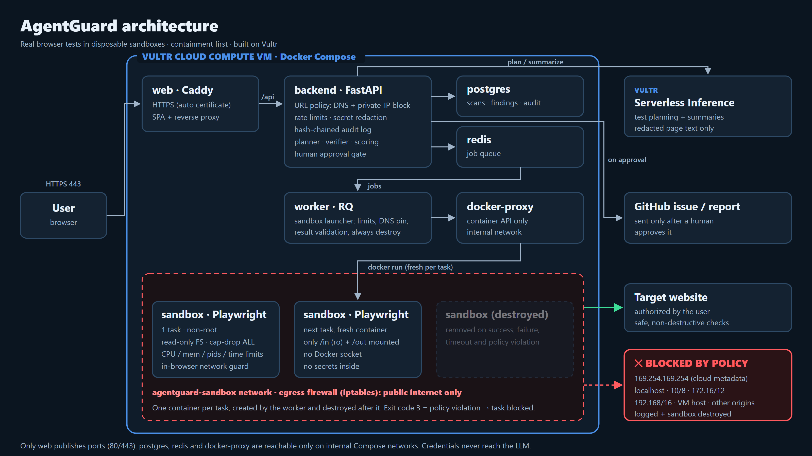

# Containment policy

Owner: Arslan · Reviewer: Sarah · Brief sections 6.4, 6.9, 12, 13

AgentGuard drives a real browser against websites chosen by users. We treat three things as hostile: the target site, the page content, and anything the browser produces (screenshots, logs, `result.json`). The goal is that a malicious target, a prompt-injected page or a bug in a check can't:

- reach anything except the authorized target on the public internet
- touch the host
- leak secrets
- erase the record of what happened

## Layers

A scan has to pass every layer in turn. Each layer works on its own and doesn't trust the one before it.

| # | Layer | Where | What it stops |
|---|---|---|---|
| 1 | **URL policy** at scan creation and again before each sandbox launch | `backend/app/policy/url_policy.py` | Non-http(s) schemes; credentials in URLs; internal hostnames (`localhost`, `*.internal`, single-label names); any DNS answer in a private, loopback, link-local, CGNAT, multicast or metadata range, including IPv4 hidden in IPv6 and shorthand like `127.1` or `0x7f000001` |
| 2 | **DNS pinning** | `backend/app/sandbox/launcher.py` (`--add-host`) | DNS rebinding: the sandbox resolves the target to the IPs the policy approved |
| 3 | **Rate limits** | `backend/app/policy/rate_limit.py` | Flooding: 10 scans per user and 6 per target host per hour |
| 4 | **Container limits** | `backend/app/sandbox/launcher.py`, `sandbox-worker/Dockerfile` | Escape and resource abuse (flags below) |
| 5 | **In-browser network guard** | `sandbox-worker/checks/netguard.py`, `checks/context.py` | Every request the page makes is vetted before it leaves, every redirect hop is checked, WebSockets are guarded, service workers are blocked. A blocked navigation ends the task with exit code 3 |
| 6 | **Egress firewall** | `scripts/sandbox-egress.sh` (iptables, `agentguard-sandbox` network) | Everything layer 5 might miss: private, loopback, link-local and metadata ranges and the VM itself are dropped at the host. DNS goes only to the host's upstream resolvers, and only public TCP is allowed |
| 7 | **Untrusted output handling** | `backend/app/sandbox/launcher.py` | Symlinks, FIFOs and devices in `out/` are deleted, never followed. `result.json` over 5 MiB is not read; anything invalid becomes `error`; exit 3 always means `blocked` |
| 8 | **Secret redaction** | `backend/app/policy/redaction.py` | Tokens, cookies, Authorization headers, passwords and API keys are redacted from evidence files, findings, audit events and LLM input |
| 9 | **Audit log** | `backend/app/policy/audit.py` | Hiding what happened: an append-only, hash-chained log of every allowed and blocked action; editing, deleting or reordering any entry is detected |
| 10 | **Docker API proxy** | `docker-compose.yml` (`docker-proxy`) | The worker reaches Docker only through a proxy that allows the container API alone: no image pulls, exec, builds, networks or volumes. Sandboxes have no Docker access at all |
| 11 | **Human approval** | API approvals endpoint | Nothing is sent outside (GitHub issue, report email) without a person approving it |

## Container flags (one fresh container per task)

| Control (brief 12) | How |
|---|---|
| Destroyed after every task | `--rm` plus an explicit `docker rm -f` in `finally`, which runs on success, failure, timeout and policy violation |
| Time limit | the launcher kills it after `min(task.timeout_s + 30, SANDBOX_TIMEOUT_S)` seconds |
| CPU / memory / processes | `--cpus`, `--memory` = `--memory-swap` (no swap), `--pids-limit 256`, `--ulimit nofile` |
| Non-root, no privileges | image user `pwuser`, `--cap-drop=ALL`, `--security-opt=no-new-privileges` |
| Read-only root filesystem | `--read-only`; `/tmp` is a `noexec,nosuid,nodev` tmpfs |
| No host filesystem | only `<work>/<scan>/<task>/in` (read-only) and `out`; `/`, system dirs and any `docker.sock` are refused |
| No Docker socket, no secrets | the env holds only `HOME`, `AGENTGUARD_IN`, `AGENTGUARD_OUT`; no credentials in argv, env or image |
| Restricted egress | the dedicated `agentguard-sandbox` network (never `host`, `bridge` or `container:`), plus layers 5 and 6 |

## What the checks themselves may do

Brief section 13 rules, enforced in code:

- **Marked, inert probe values** only: `agentguard-probe-<id>`, and redirect probes target the reserved `.invalid` domain.
- **No following redirects** for probes (`max_redirects=0`), so a check can't be bounced to a URL the policy never saw.
- **Fixed, GET-only endpoint list:** `/admin`, `/debug`, `/.env`, `/server-status`.
- **Login rate probe:** at most 3 attempts, hard-coded, with a fake marked account.
- **No exploitation, no data changes, no brute force.**
- Secret values the checks discover (session ids in URLs, `.env` contents) are **never copied into evidence**, only their names.

## The containment moment (demo)

The `security.exposed_endpoints` task with `params: {"containment_demo": true}` asks the policy for `http://169.254.169.254/latest/meta-data/`. What happens next:

1. The policy blocks it, so the check stops (`PolicyViolation`).
2. The runner marks the task `blocked`, writes the blocked event to `policy_events`, and exits with code 3.
3. The launcher records `navigate / blocked` (target and reason) in the audit log, then destroys the container and records `sandbox_destroyed`.
4. The web app's progress view shows these events as the red "Blocked by policy" event and the destroyed-sandbox indicator (brief 6.1).

The metadata address is never actually contacted. If a broken policy ever allowed it, the check refuses and the task ends `error` instead. Params can switch the demo on but can't change the URL.

## Verification status

| Control | Verified by |
|---|---|
| URL policy, DNS rebinding, redirect re-checks | `backend/tests/test_policy_url.py` (fake DNS, fake HTTP) |
| Container flags, mount refusal, teardown on every path, output sanitizing | `backend/tests/test_sandbox_launcher.py` (fake Docker) |
| In-browser network guard | `sandbox-worker/tests/test_netguard.py`, plus a real-Chromium test (`AGENTGUARD_LIVE_BROWSER=1`) |
| Egress firewall rules | `sandbox-worker/tests/test_egress_script.py` (dry-run output), shellcheck |
| Redaction, audit chain (incl. 4 processes appending), rate limits | `backend/tests/test_policy_{redaction,audit,rate_limit}.py` |
| Probe safety rules and the demo trigger | `sandbox-worker/tests/test_security_probes.py`, plus a real-Chromium smoke run |
| Docker proxy and port exposure | `backend/tests/test_deploy_config.py` (resolved compose config) |
| **Needs the live VM** | iptables rules on a real Docker host, the end-to-end demo through the UI, image builds on the VM. See the containment smoke test in [deploy-vultr.md](deploy-vultr.md) |

## Known limits

- **The worker is trusted.** Through the proxy it can still create containers, so the worker must only ever run our own code. Sandboxes never get that access.
- **Pinned DNS doesn't cover other hosts.** It applies to the target host. Requests to other hosts are blocked by layers 5 and 6, not pinned.
- **Logging in hits the real site.** Login and form checks interact with the target, within the safe-probe limits above. Only scan sites you're authorized to test.
